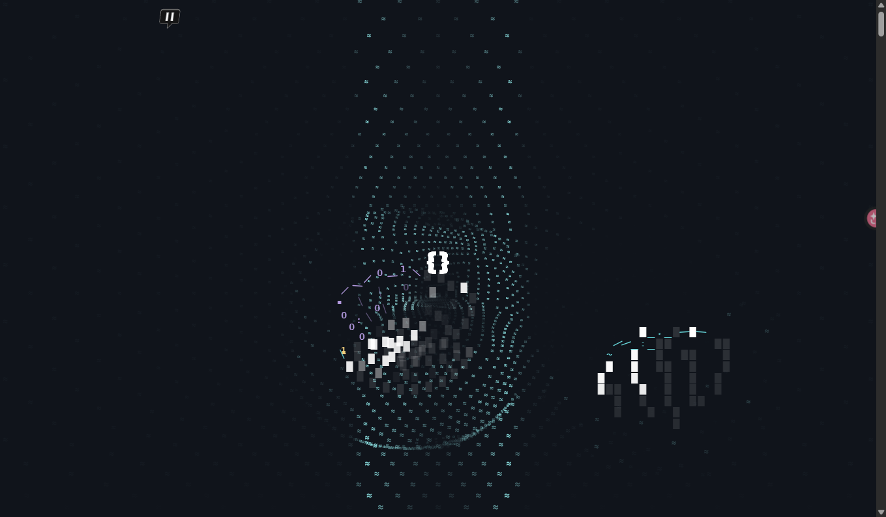
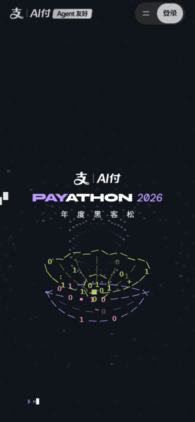

# Cool UI Gallery

这里专门放好看的 UI，先看图，再看源码。

## 1. Payathon 2026

Vue 3 + Vite 活动页，包含赛道切换、移动端响应式布局和活动日历。

| 桌面端 | 移动端 |
|---|---|
|  |  |

[打开 Payathon 图片目录](showcase/payathon-2026) · [打开源码](showcase/payathon-2026/app) · [查看规格](showcase/payathon-2026/UI-SPEC.md)

## 2. MOTDES

Astro + WebGL 动态作品集，包含流体背景、粒子效果、视频作品墙和滚动叙事。

[打开 MOTDES 预览图](showcase/motdes/preview) · [打开源码](showcase/motdes/app/motdes)

## 文件怎么找

- 想看图片：进入每个案例目录里的 `preview` 或直接看上面的首页图片。
- 想看源码：进入 `app`。
- 想运行项目：打开对应 `app` 目录里的 README 或 `package.json`。

以后新增 UI，只添加一个新的案例文件夹，不把源码和预览图混在根目录。
